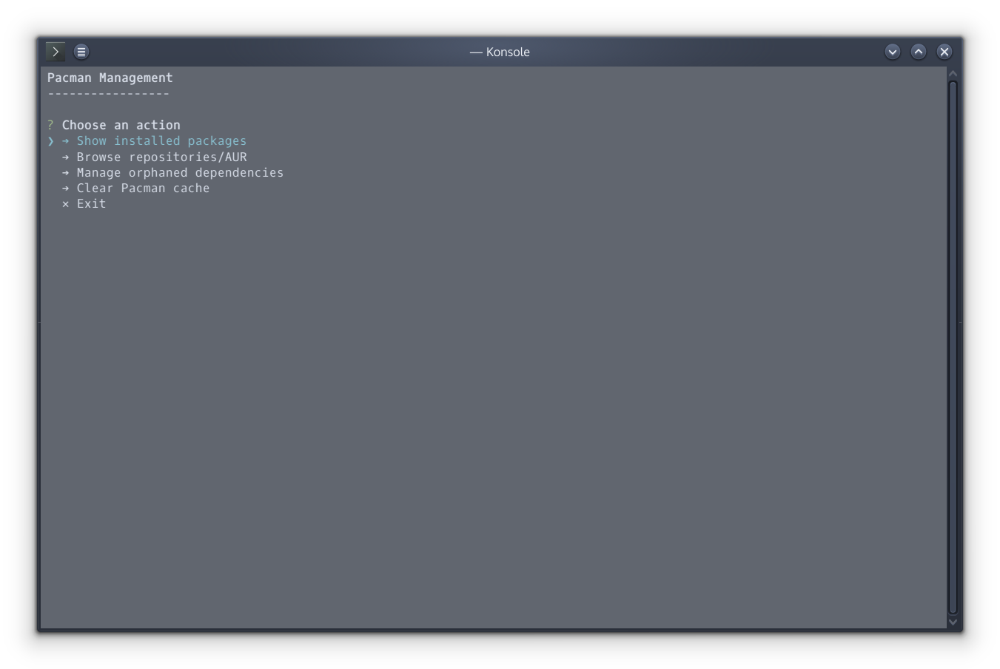
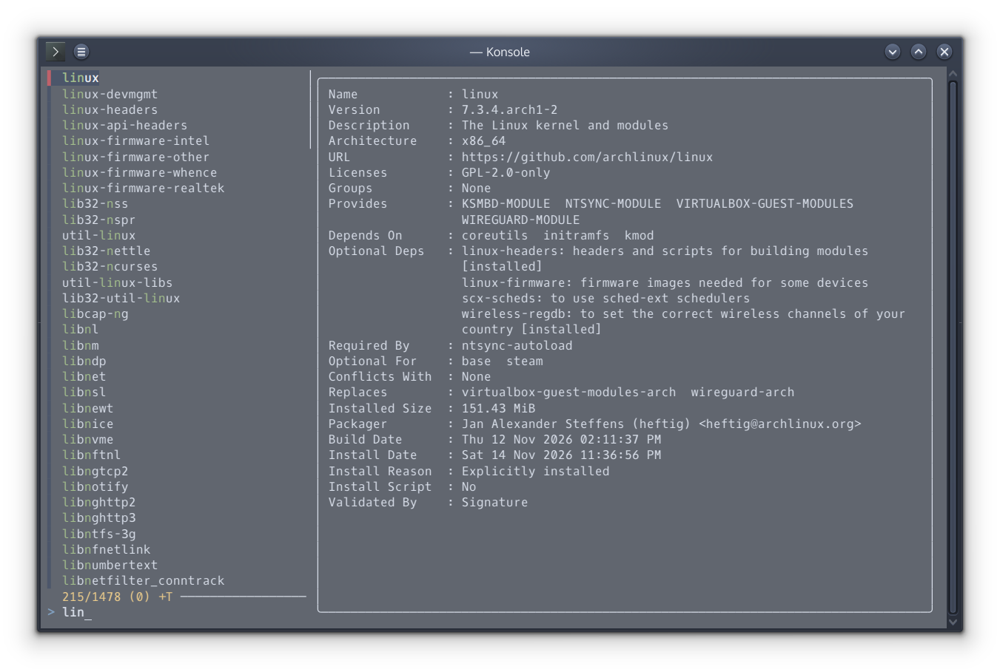
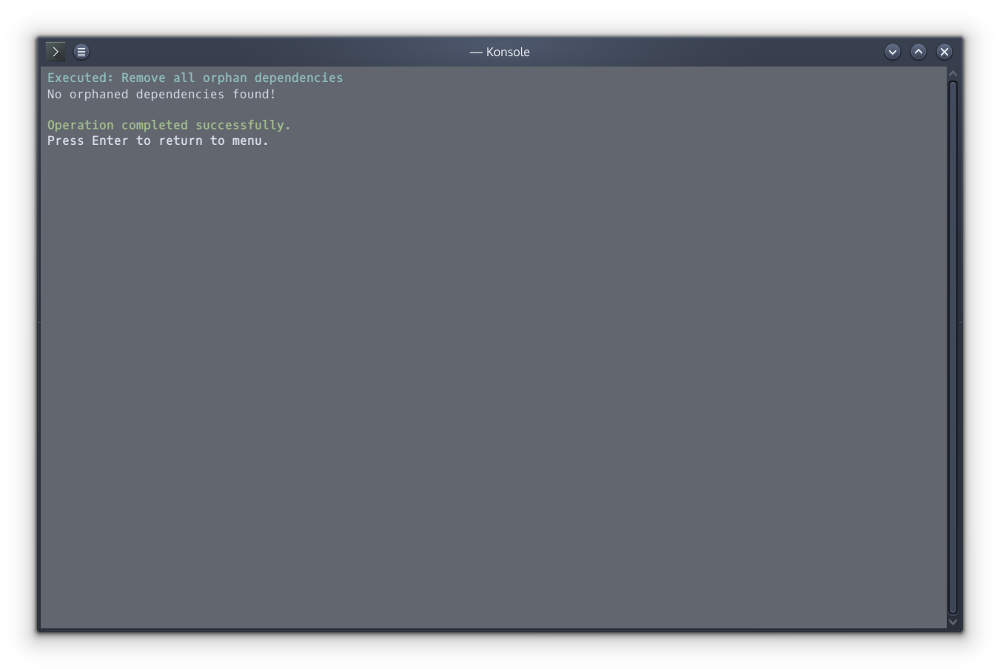
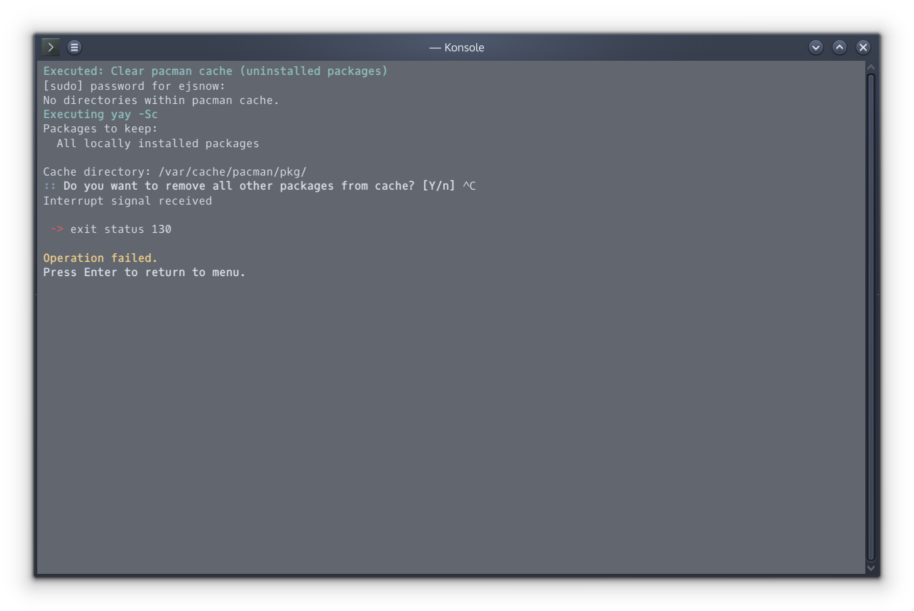

One of the downsides of Arch is its package management experience. Everything is done through a somewhat clunky CLI interface, and Arch is highly against GUI frontends such as KDE Discover as they don't show enough information from pacman during install/upgrade operations.<!-- excerpt --> Over the years, people have created several frontends to pacman with varying goals:

* [Octopi](https://tintaescura.com/projects/octopi/) - an advanced, fully-featured Qt-based GUI for pacman with AUR support
* [Apdatifier](https://github.com/exequtic/apdatifier) - a KDE extension focused on automatic update checking, but with advanced management features, an RSS reader, and flatpak support as well
* [Arch Update Checker](https://github.com/dhruv8sh/arch-update-checker) - A much simpler KDE widget focusing primarily on package updates without many management features

For my uses, a full application like Octopi felt overkill (that, and I found Octopi's interface rather unintuitive), and Apdatifier gradually became too bloated (seriously, does an update checker widget need a full RSS reader?). I recently started using Arch Update Checker, which is much more minimal, but I missed the advanced management features from Apdatifier. So I wrote a little Bash script to fill in what I felt was missing from Arch Update Checker.

## Le script

My goal was rather simple: Make a friendly TUI for key package management operations:

* Browsing repositories/AUR and locally installed packages
* View/uninstall orphan dependencies
* Refresh mirrorlist (not implemented yet)
* Clear the Pacman package cache

For now, it's fairly bare-bones, and I intend to keep it fairly minimal while still having the important features. AUR operations are also supported through yay (if you want support for xyz other AUR helper, feel free to PR support, though right now the script is hard-coded for yay).

As of 2026-11-17, the only notable thing missing from the script is mirrorlist refreshing. The TUI could use some improvements, but it's fairly usable (if slightly annoying to navigate). I used [bash-tui-toolkit](https://github.com/timo-reymann/bash-tui-toolkit) to build the menus. It's incredibly (and scarily) easy to use, and probably preserved my (already questionable) sanity (from all I've seen, writing a TUI from scratch in Bash is quite painful).

The script can be found on Github at [EJSnow/pacman-manage](https://github.com/EJSnow/pacman-manage). If you find it useful, give it a star!

Screenshots:

   

   

   

   

   

   

   

   

